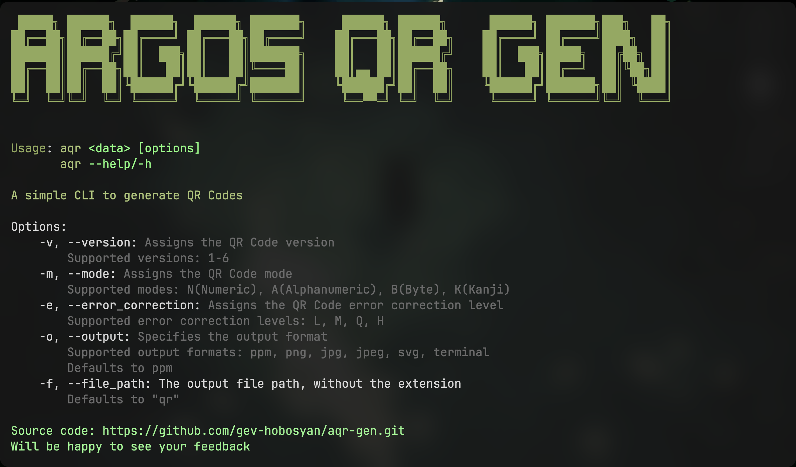

<div align="center">
    <div style="font-size: 48px; display: flex; align-items: center; justify-content: center; gap: 10px;">
        <p>Argo's</p>
        
        <p>Gen</p> 
    </div>

**Generate your QR codes with ease**

[](https://github.com/gev-hobosyan/aqr-gen/releases)
</div>

---

## What is AQR?

---

**AQR** is a simple rust based CLI tool that allows you to generate fully customizable QR codes locally.

---

## Tech Stack

- Rust
- Clap - for CLI implementation

---

## Features

---

- **Fully customizable** - You can choose the version, error correction level and the output format.
- **Local** - There's no central server. Everything happens on your device
- **Fast** - Type the command and get your QR code right away.

---

## Getting Started

---

### 📥 Installation

####  MacOS

##### 🍺 Homebrew

```bash
    brew install --HEAD argo/aqr/aqr@0.1
```

##### 💾 Direct binary download

1. Download the latest version of the [app](https://github.com/gev-hobosyan/aqr-gen/releases/latest)
2. Unzip the package
3. Give it the permission to run
4. Move the binary to a directory in your system PATH
```bash
    chmod +x aqr
    mv aqr /usr/local/bin/aqr
```

##### Windows
Support will be added later....

---

## How to use?

### Help command

```bash
    aqr --help
    # or
    aqr -h
```

### Generating a QR code

```bash
    aqr "insert your data"
```

Yes it's that simple.
<br />
The app will generate a qr.ppm file containing your QR Code.

### Customization

#### Version

```bash
    aqr "your data" -v 4
    # or
    aqr "your data" --version 4
```

⚠️ Warning: The app currently supports only version 1-6. The rest will be added later.

#### Mode

```bash
    aqr "your data" -m B
    # or
    aqr "your data" --mode B
```

Supported Modes:

- B - Byte
- N - numeric
- A - alphanumeric
- K - Kanji

#### Error correction level

```bash
    aqr "your data" -e M
    # or
    aqr "your data" --error_correction M
```

Supported Levels:

- L - low (~7%)
- M - medium (~13%)
- Q - quadratic (~25%)
- H - high (~30%)

#### Output format

```bash
    aqr "your data" -o png
    # or
    aqr "your data" --output png
```

Supported Output formats:

- png
- ppm (default)
- jpg
- jpeg
- svg
- terminal (prints in the terminal using emojis)

#### File name and path

```bash
    aqr "your data" -f aqr
    # or
    aqr "your data" --file-path aqr
```

Can be used to change the output file's path <br /> 
E.g.
```bash
    aqr "your data" -f ../aqr
```

Will generate an `aqr.ppm` in the parent directory

---

## Planned features

- [ ] QR codes with telemetry
- [ ] Support for all QR code versions
- [ ] Logo insertion

And much more ...



